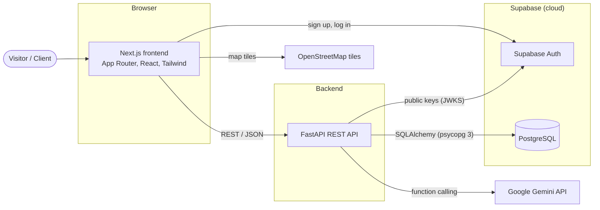
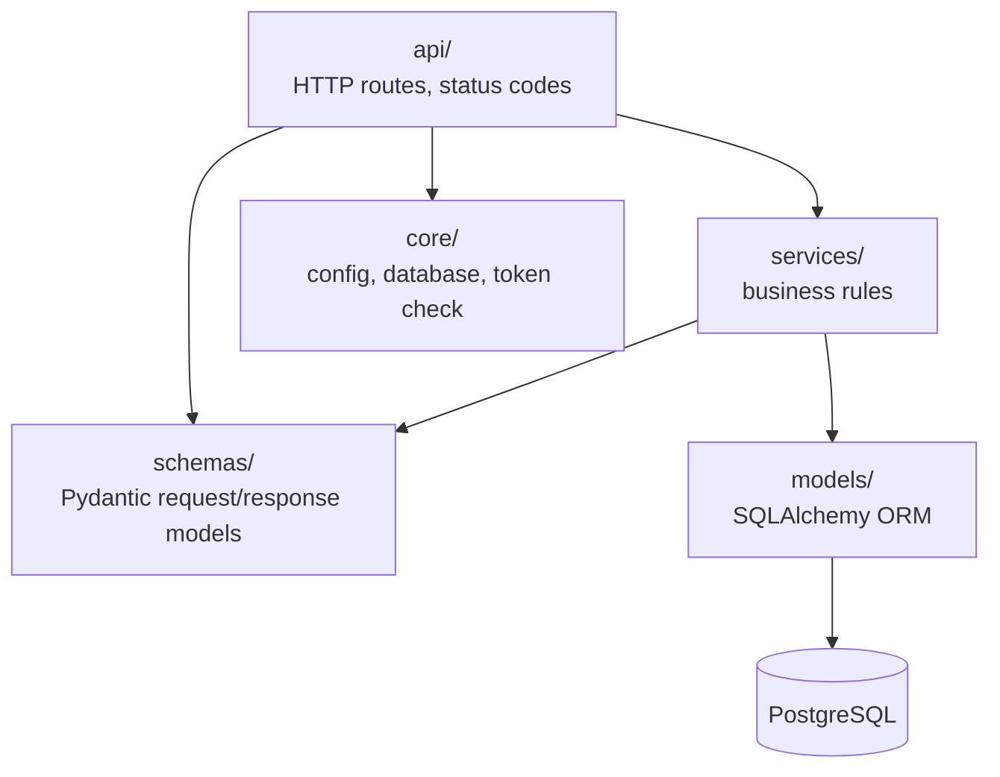
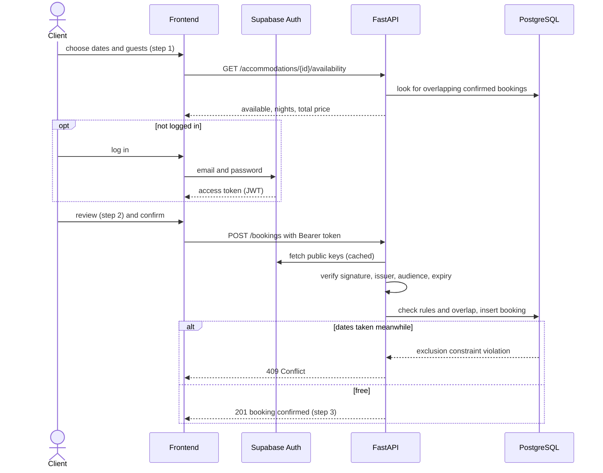

# Architecture overview

Book4You is a web platform for finding and booking accommodation. It combines classic search with a
bilingual (RO/EN) assistant that turns free-text requests into **editable** search filters.

## Actors

| Actor | Can do |
|---|---|
| **Visitor** (not logged in) | search and filter, view details and map, use the assistant, check availability |
| **Client** (logged in) | everything a Visitor can, plus book (simulated), see booking history, cancel, edit the profile |
| **LLM provider** (external, Google Gemini) | interprets one message into JSON. Called only by the backend. No database access |

## System context

The browser talks to Supabase **only for authentication**. All data goes through the backend.
(Demo photos are placeholders loaded from `picsum.photos`.)

## Technology stack

| Layer | Technology |
|---|---|
| Frontend | Next.js 16 (App Router), React 19, TypeScript (strict), Tailwind CSS v4, Leaflet 1.9, supabase-js 2, own typed RO/EN dictionaries |
| Backend | Python 3.13, FastAPI, Pydantic v2, SQLAlchemy 2, Alembic, PyJWT, httpx, Uvicorn |
| Data and auth | Supabase: PostgreSQL and Supabase Auth |
| Assistant | Google Gemini (Interactions API, `gemini-3.5-flash-lite`), with keyword-rule fallback |
| Tests | Pytest (+ pytest-cov) |

## Backend structure

- Routes only handle HTTP. Rules live in `services/` and raise domain errors
  (`NotFoundError`, `ConflictError`, `RuleViolationError`) that routes map to 404, 409 and 422.
- `services/chat/` contains the assistant: Gemini client, validation, fallback rules.

## Frontend structure (`frontend/src`)

| Folder | Content |
|---|---|
| `app/` | routes: `/`, `/accommodations`, `/accommodations/[id]`, `/bookings`, `/login`, `/signup`, `/profile`, 404 |
| `components/search` | `SearchBox`, `FilterPanel`, `ResultsView`, `AccommodationCard`, `Pagination` |
| `components/map` | `MapView` (Leaflet, browser only) and its error boundary |
| `components/chat` | `ChatPanel`, `FilterChips` |
| `components/booking` | `BookingCard` (3 steps), `MyBookings` |
| `components/details`, `components/auth`, `components/layout` | details page, login and profile, navbar and footer |
| `auth/`, `i18n/`, `lib/`, `types/` | session, RO/EN dictionaries, API client, shared types |

**The URL is the single source of truth for a search.** The search box, filter panel, chips and
pagination all write the URL, and the results follow. Searches can be shared and the back button works.

## Booking flow

## Security

- **Authentication:** the backend verifies Supabase tokens with the project's public keys (ES256).
  Only asymmetric algorithms are accepted. Passwords never reach the backend.
- **Authorization:** users only see and cancel their own bookings. Someone else's booking answers 404.
- **Database:** Row Level Security is enabled on every table, so the public Supabase key cannot
  read them through Supabase's REST API. An `EXCLUDE` constraint prevents double booking.
- **Input validation:** every request is validated with Pydantic. Search text cannot inject SQL
  wildcards.
- **LLM output** is untrusted: validated field by field, and nothing is executed on its behalf.
- **Secrets** (database password, LLM key) exist only in the backend `.env`, never in git. The
  frontend only has public values.
- **Browser:** CORS limited to the frontend origin, redirect after login limited to local paths,
  map popups built from text (no HTML injection).

## Requirements coverage

| ID | Requirement | Status in the prototype |
|---|---|---|
| CF-01 | Register, login, logout, profile | Done (Supabase Auth). Booking requires login |
| CF-02 | Catalog and details page | Done. Photos are placeholders |
| CF-03 | Search with filters, sort by price, pagination, availability | Done |
| CF-04 | RO/EN assistant to editable filters, clarifying question | Done. Activities are shown but do not filter |
| CF-05 | Map synced with results, location on details | Done. Nearby points of interest not included |
| CF-06 | Availability, simulated booking, history, cancel, no overlap | Done |
| CF-07 | Semantic search (pgvector) | Out of scope for Report 2 |

| Non-functional requirement | How it is met |
|---|---|
| Responsive | Tailwind breakpoints. Checked at 390, 768 and 1366 px wide |
| RO/EN | Typed dictionaries (a missing translation fails the type check) |
| Booking in at most 3 steps | Choose, review, confirmation on the stay page |
| Classic search under 1 s | About 160 ms median against the cloud database ([testing](testing.md)), indexes on filtered columns |
| Progress indicator for the LLM | "Reading your message…" with animation |
| Validation and server-side keys | Pydantic everywhere, keys only in backend `.env` |
| Search works if the LLM is down | Search never calls the LLM. The assistant falls back to keyword rules |

## Known limitations

- Demo data: 50 fictional stays in real Romanian locations, English descriptions, placeholder photos.
- City search matches names, not distance ("near Brașov" does not include Bran).
- The map shows the stays of the current results page.
- No rate limiting on `/chat/parse`.
- On Gemini's free tier, requests are used by Google to improve its products, so the assistant
  should not receive personal data.
- Chat history is not saved. The language choice is stored in the browser.
- Bookings have no payment and no cancellation deadline in the API.

## Planned for the final report

Semantic search (embeddings + pgvector), Playwright end-to-end tests, GitHub Actions CI, Docker
Compose, Redis caching, Stripe test mode, OpenStreetMap points of interest, real photos.
