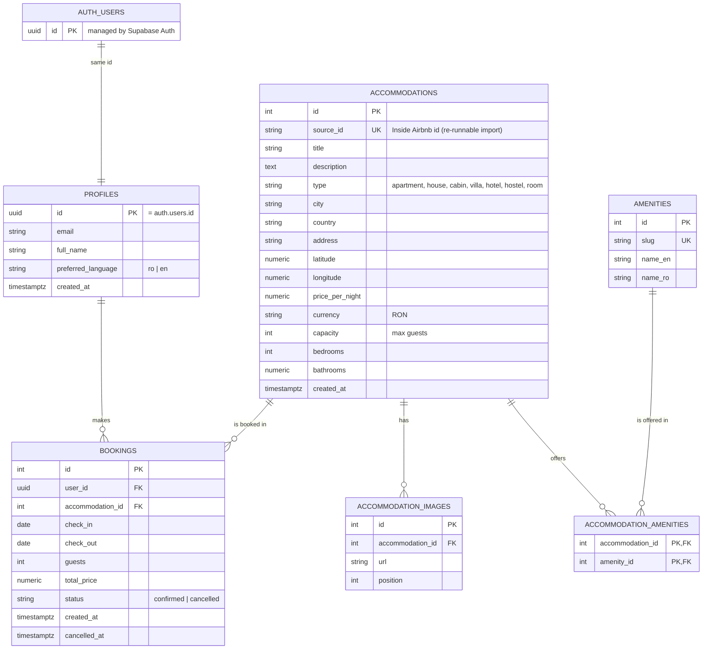

# Database schema

PostgreSQL on Supabase. Schema managed with SQLAlchemy models (`backend/app/models/`) and
Alembic migrations (`backend/alembic/versions/`).

## ER diagram



## Design decisions

- **Indexes** on the filtered columns (`city`, `type`, `price_per_night`, `capacity`) keep classic
  search fast (NF: under 1 second). `bookings` has an index on
  `(accommodation_id, check_in, check_out)` for availability checks.
- **No overlapping bookings (CF-06).** Two bookings overlap if
  `new.check_in < existing.check_out AND new.check_out > existing.check_in`. Only `confirmed`
  bookings count, so cancelling frees the period. The service layer checks this to return a
  friendly error, and an `EXCLUDE USING gist` constraint on `bookings` enforces it in the
  database, so even two simultaneous requests cannot double-book. A stay may start on the day
  the previous one ends.
- **Status and type as text + CHECK constraints** (not PostgreSQL enums), so adding a value is a
  simple migration.
- **Bilingual amenities:** `name_en` and `name_ro` are stored per amenity.
- **Row Level Security** is enabled on every table with no policies. The browser only uses
  Supabase for Auth; all data goes through the FastAPI backend, which connects as the table
  owner (bypasses RLS). This blocks the public anon key from reading tables through Supabase's
  auto-generated REST API.
- `profiles.id` references `auth.users(id)` with `ON DELETE CASCADE`.

## Supabase setup (once per project)

1. Create a free project at <https://supabase.com> (choose a region close to you and save the
   database password somewhere safe).
2. Click **Connect** at the top of the dashboard, open the **Session pooler** tab and copy the URI.
   Use the session pooler (works over IPv4); the direct connection is IPv6 only.
3. In `backend/.env` set `DATABASE_URL` to that URI, with `[YOUR-PASSWORD]` replaced by your real
   password. If the password contains special characters (`@ : / # ?`), URL-encode them.
4. Apply the schema:

   ```bash
   cd backend
   source .venv/bin/activate        # Windows: .venv\Scripts\Activate.ps1
   alembic upgrade head
   ```

5. In the Supabase dashboard, **Table Editor** should now list the 6 tables.

Useful commands: `alembic current` (applied version), `alembic check` (do the models match the
database?), `alembic downgrade base` (drop everything).
