# Prototype screenshots

Taken on 25 November 2026 from a production build with the demo catalog in a local test database and a
test user (no real accounts). In the assistant screenshots the filters were extracted by the fallback
rules, not by Gemini; the screens look the same in both cases. Photos are placeholders.

## 1. Home: hero with the search box

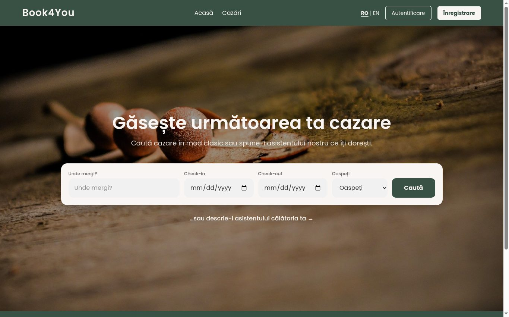

## 2. Search results with filter panel, cards and synced map

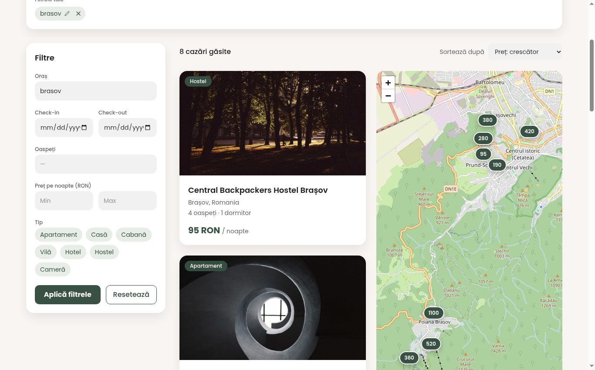

## 3. Assistant: a Romanian request turned into editable chips

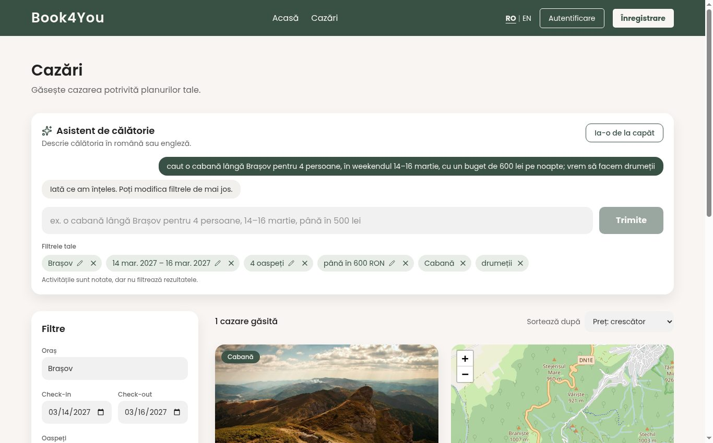

## 4. Assistant: clarifying question when the destination is missing

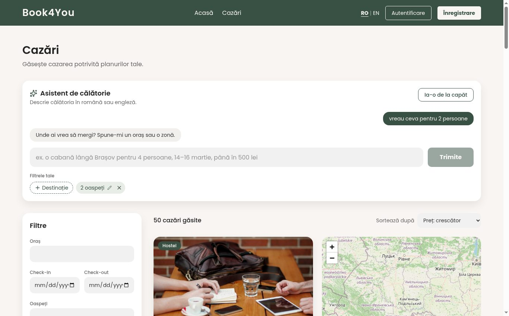

## 5. Login

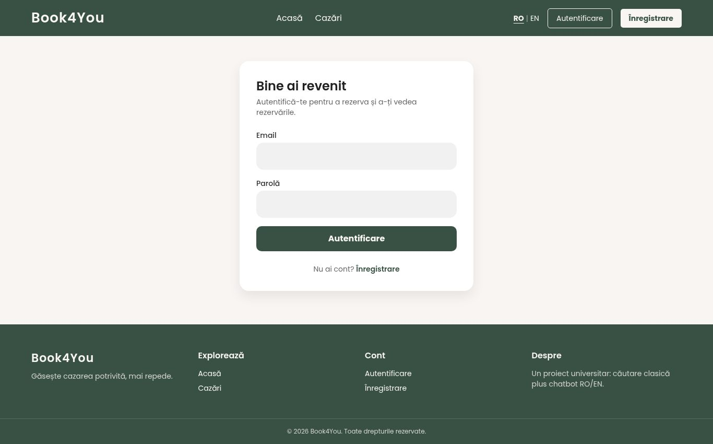

## 6. Accommodation details and booking card

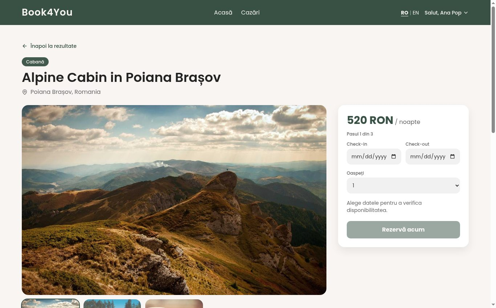

## 7. Booking step 1: dates, guests, availability

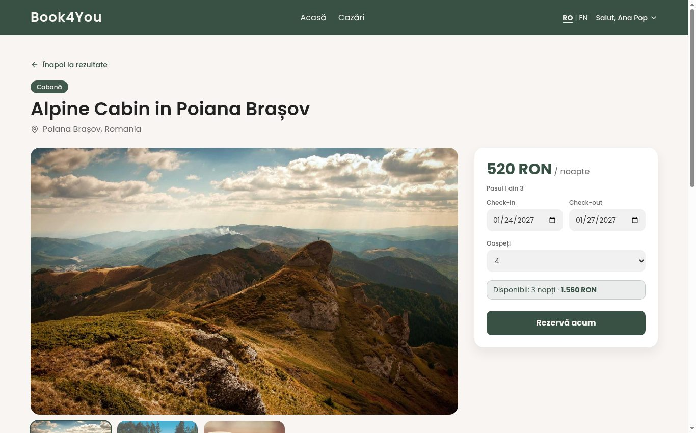

## 8. Booking step 2: review

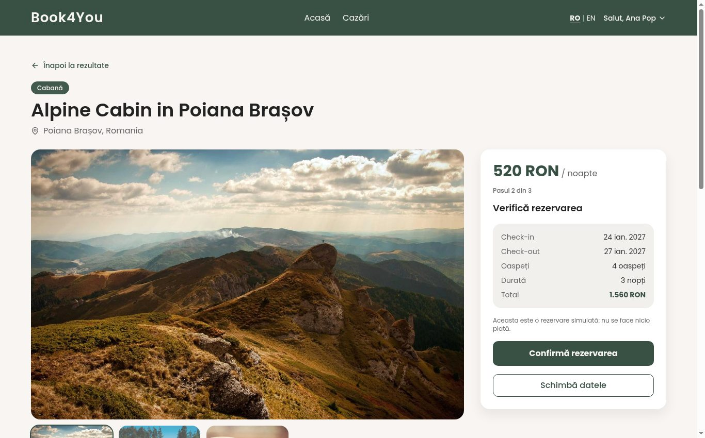

## 9. Booking step 3: confirmation

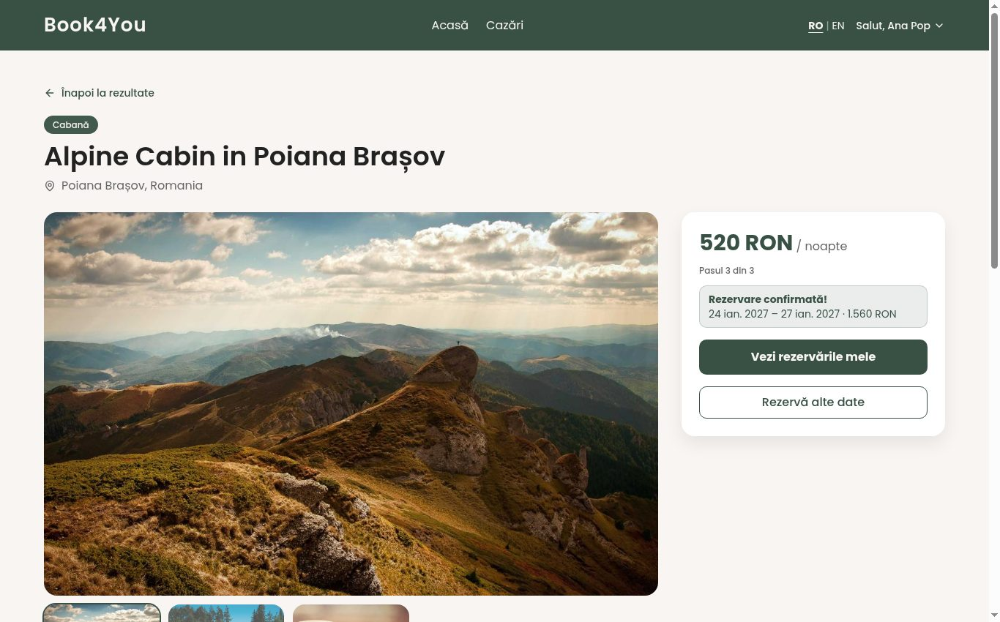

## 10. My bookings with cancellation

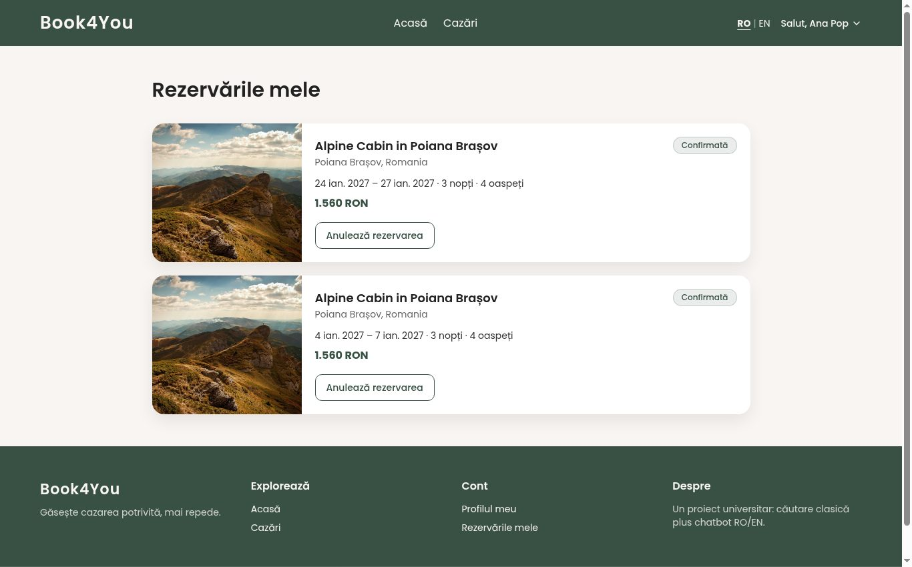

## 11. Phone: home

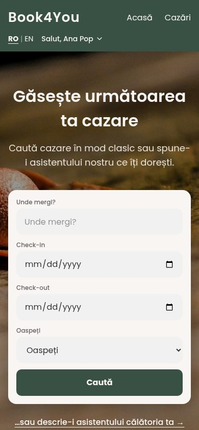

## 12. Phone: results with the List / Map toggle

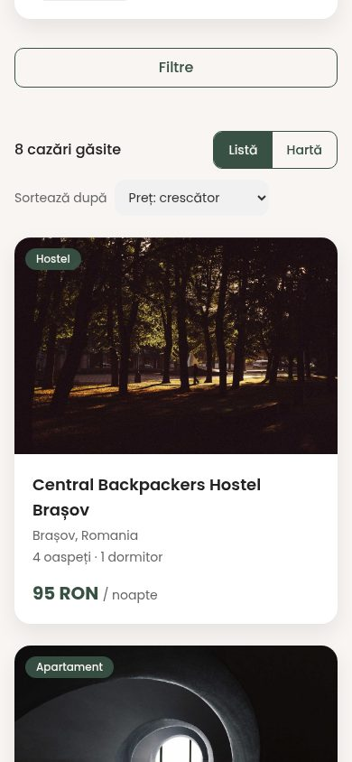
